# Player polish: tooltips, looping, "Hear it played", sheet music

Work done in four parts, each committed on its own. Screenshots are in `docs/player-polish/shots/`.
Decisions made along the way are noted under each part.

## Part 1: tooltips

**The problem.** The little labels on the buttons at the top of the player opened above the button, so
the top of the window cut them off. They were drawn with CSS inside the button, so any parent that
clips its contents could also cut them.

| Before | After |
| --- | --- |
|  |  |
| 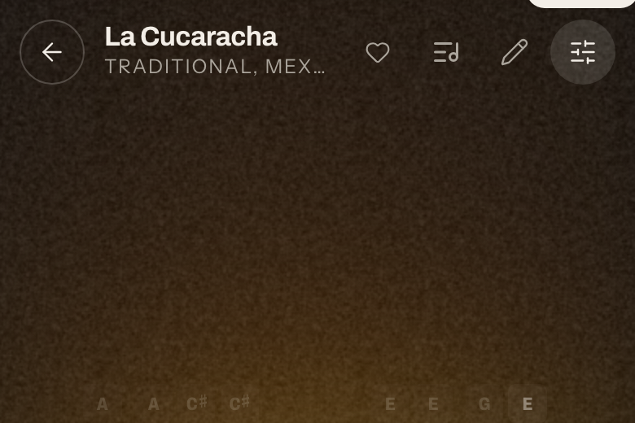 | 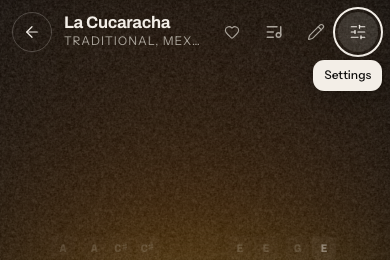 |
|  | 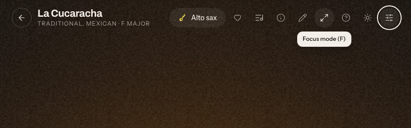 |

**What changed.**

- One tooltip for the whole app (`web/src/components/TooltipLayer.tsx`). It is drawn in its own layer
  on top of the page and placed with Floating UI (`@floating-ui/dom`, MIT licence). It opens on the
  preferred side, flips to the other side when there is no room, and slides along the window edge
  instead of crossing it. No parent can clip it.
- The buttons at the top of the player now ask for "below".
- Everything that used the browser's own `title` tooltip (note chips, the instrument list, the "unsure"
  dot, "Add a note here") now uses the same tooltip, so they all look and behave alike.
- Timing: the first tooltip waits about a third of a second. Moving along a row of buttons then swaps
  the text at once, with no blink in the gaps between buttons. A click puts the tooltip away.
- Keyboard: moving with Tab shows the tooltip of the focused button; Esc closes it.
- Touch: a finger doesn't hover, so tooltips stay out of the way. The small "i" marks in Settings open
  on a tap.

**How it was checked.** A Playwright script hovered every element with a tooltip on the home page,
My songs, a song's page, the player, the player with Settings open and the player in edit mode, at
1440×900, 834×1194 (iPad), 390×844 (phone) and a short 1024×600 window. For each one it checked that
the tooltip was fully inside the window, showed the right text and did not cover its own button.
Result: 305 tooltips checked, 0 clipped or wrong. Sweeping the mouse across the row of top buttons:
6 tooltips seen, 0 moments without one. First tooltip: closed at 120 ms, open at 520 ms.

**Decisions.**

- Floating UI rather than Radix Tooltip: the app already marks tooltips with a `data-tip` attribute in
  about forty places; one small layer that reads that attribute fixes all of them without wrapping
  every button in a component.
- Tooltips are hints for the eye only. Every button keeps its own `aria-label` for screen readers.

## Part 2: looping

**The problem.** Dragging along the progress bar to move through the song left a loop behind, so the
song kept jumping back and it wasn't obvious why or how to stop it.

**Before and after: the same drag along the bar.**

| Before (a loop appears) | After (it only moves the song) |
| --- | --- |
| 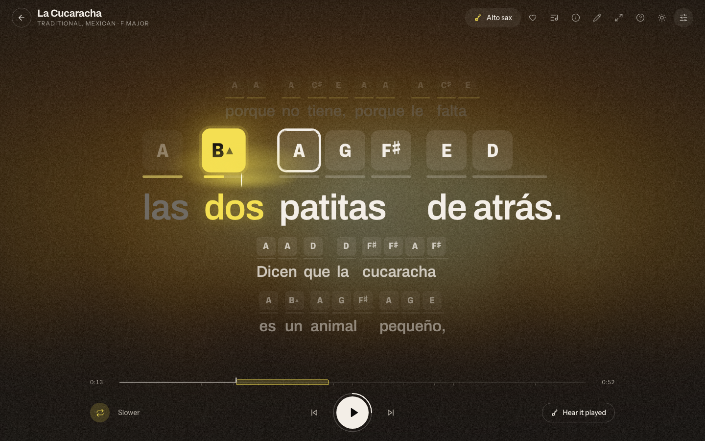 | 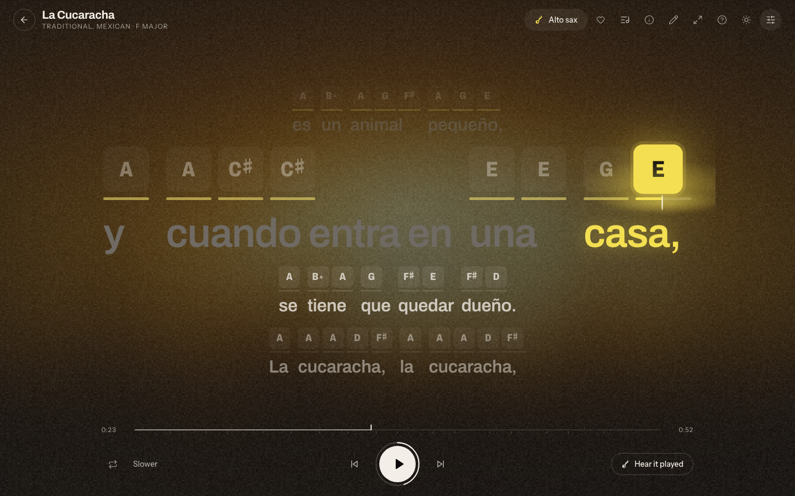 |
|  |  |
|  |  |

**The new loop.**

| One line | Two lines (end handle dragged) | Phone |
| --- | --- | --- |
|  | 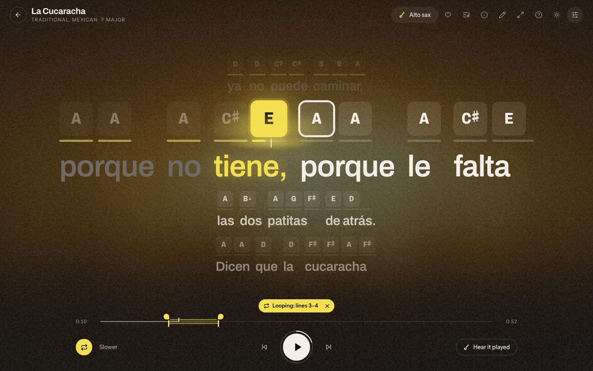 | 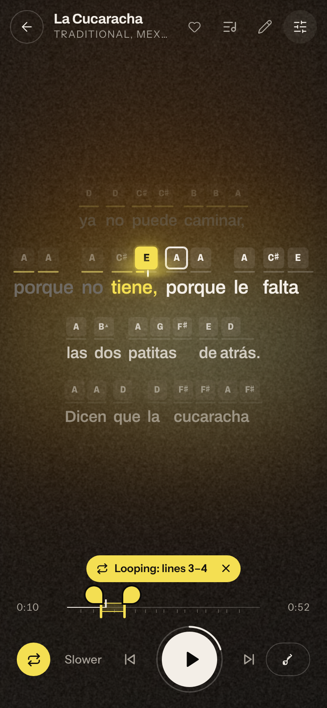 |

The one-time tip: 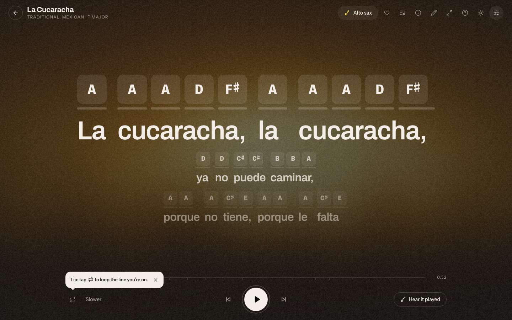

**How it works now.**

- The bar only moves the song: drag to scrub, click or tap to jump. It never makes a loop, with a
  mouse or a finger.
- Looping is a deliberate act: the loop button (left of "Slower") or the L key loops the lyric line
  you are on. The button is filled yellow while a loop is on.
- While looping, the looped part is marked on the bar with a handle at each end. Drag a handle to take
  in more or fewer lines; it snaps to the starts and ends of lines. Hold Alt (Option) to place it
  freely. With the keyboard, Tab to a handle and use the arrow keys. On touch screens the handles are
  large enough for a thumb.
- A yellow chip above the bar says what is looping, "Looping: lines 4–5", with a ✕.
- To stop: the ✕, the loop button again, L again, or Esc.
- Clicking a lyric line outside the loop grows the loop to take that line in.
- The first time the player opens, a small note by the loop button says "Tip: tap ⟳ to loop the line
  you're on." It is shown once per browser and never again.
- Loops are still saved with the song and come back after a reload.

**Inside a loop.** Jumping (clicking the bar, previous/next line) stays inside the loop; next on the
last looped line goes round to the first. Speed, key changes, the timing guide and "Hear it played"
carry on as normal.

**Timing fix found on the way.** With "Hear it played" on, the first note after each trip round the
loop came in 40 to 55 ms early. Cause: for a moment after a jump the audio stands still (about 40 ms
in Chrome) while the app's clock had already set off, and the first note was booked in that moment.
Now the clock waits until the audio is really moving at speed, nothing is booked while a jump is in
progress, notes past the loop's end are not booked at all, and a note that is waiting is moved if the
clock is corrected after it was booked.

**How it was checked.**

- `looptest.mjs` (Playwright, at 1440×900, 834×1194 and 390×844): the tip shows once and not after a
  reload; a mouse drag, a click and a finger swipe on the bar move the song and make no loop; the
  button, L, Esc, ✕ start and stop a loop; handles snap to lines, move freely with Alt and can't cross
  each other; the loop survives a reload. All passed at all three sizes.
- `web/scripts/check-loop.mjs` (kept in the repo): plays La Cucaracha looping two lines with "Hear it
  played" on, four times round, then changes key and goes three more times round, at full and half
  speed. Result: the song was never outside the loop (0 ms); 129 notes timed at full speed, worst
  21 ms; 126 at half speed, worst 15 ms; no note from outside the loop was played.
- `web/scripts/check-hear-sync.mjs` over the whole song still passes: worst 12 ms at full speed, 15 ms
  at half speed, no drift.

**Decisions.**

- The chip sits in its own row above the bar, centred, so it can't be missed and never covers the
  handles (on touch screens it sits a little higher to clear the larger handles).
- The label counts lyric lines ("line 4", "lines 4–5"). A loop placed freely with Alt shows times
  instead ("0:18–0:24").
- Esc closes things in this order: an open panel, then the loop, then focus mode.
- The tip counts as seen as soon as it has been shown, so it can't come back.
- A loop starts 0.15 s before the line and ends 0.2 s after it, so the first note isn't clipped.

## Part 3: "Hear it played"

### The button

| Off | On | Other instruments (on) |
| --- | --- | --- |
| 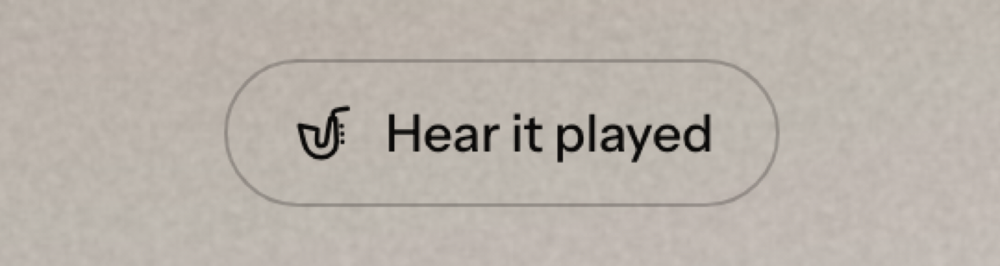 |  | 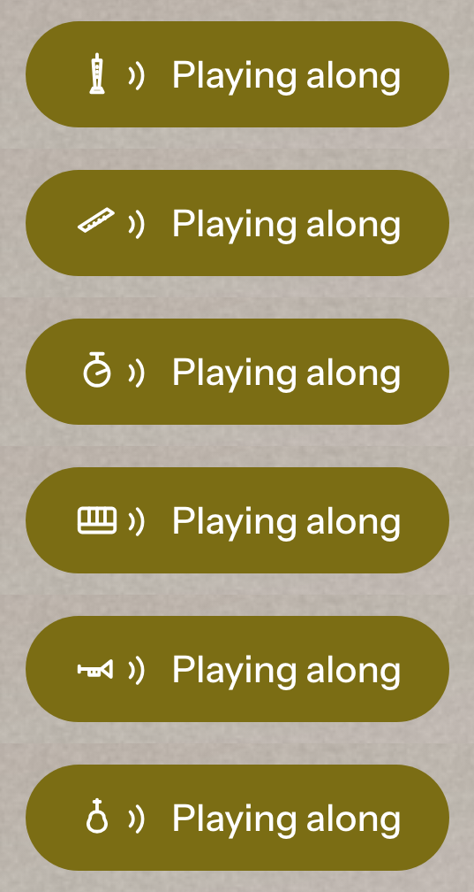 |

In the player: 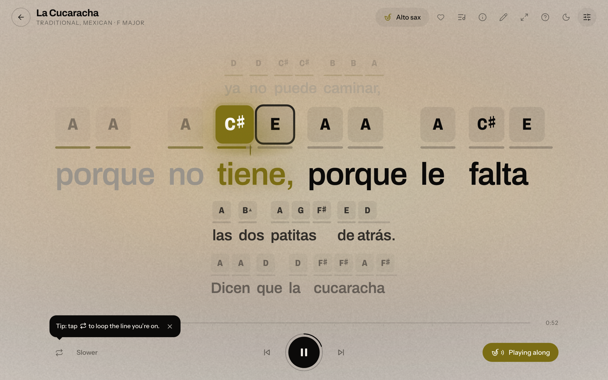

| iPad | Phone (icon only, to fit) |
| --- | --- |
| 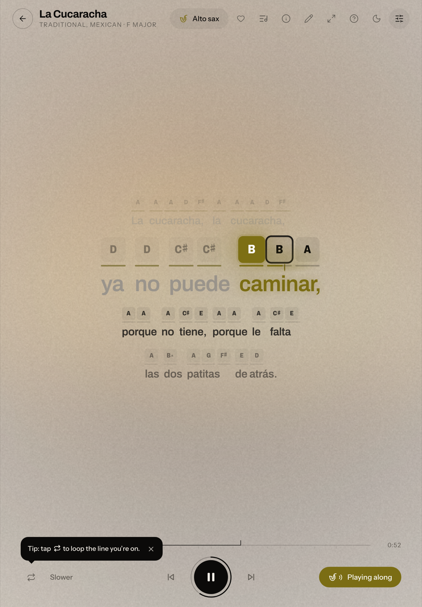 | 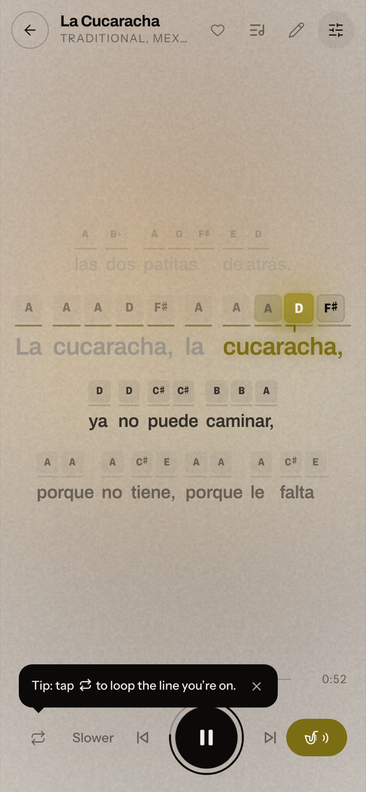 |

- A saxophone drawn for the app, with the same line weight as the other icons. Off: outline, "Hear it
  played". On: filled in the accent colour, "Playing along".
- Two small sound waves beside the icon pulse each time a note actually sounds (driven by the same
  clock as the sound, so they are in time). With "reduce motion" on they stay still.
- The icon follows the instrument: saxophones, clarinet, flute, trumpet and other brass, horn, violin
  and other strings, piano, voice each have their own drawing (the right column above shows clarinet,
  flute, horn, piano, trumpet, violin).

### The sound

Four ways of playing the alto sax were built and compared. The files are in
`docs/listening-samples/sax-sound/` (its README names each one).

| Approach | Source and licence | Distance from a real player, La Cucaracha / Despacito (lower is closer) |
| --- | --- | --- |
| Old sound: 9 notes, one loudness | University of Iowa, free for any use | 0.72 / 0.88 |
| New recordings, plain: every semitone, soft and loud, two takes each | Karoryfer Weresax, CC0 | 0.46 / 0.69 |
| **New recordings with phrasing (shipped)** | same | **0.33 / 0.66** |
| Physical model (reed and tube) | written here after STK "Saxofony" (MIT-style) | 1.13 / 1.43 |

- **What phrasing adds.** Notes that run together are lightly tongued, or slurred when a quick note
  moves by step inside one word. A phrase starts with a clear attack and now and then a small scoop up
  to the note. Long notes grow a gentle vibrato after the first third of a second. A little breath on
  attacks, a soft roll-off at the top, a little room. Loudness follows how the singer sang each note
  when there is a singer (new `/api/songs/{id}/dynamics`), and the shape of the tune when there is not.
  Soft notes use the soft recordings and loud notes the loud ones, so the tone changes with loudness as
  on a real sax. Two takes of each note alternate, so repeated notes are not identical.
- **Neural models (DDSP and similar) were looked at and not used.** The ready-trained sax models are
  either under non-commercial licences or trained on recordings whose licence does not allow commercial
  use; training our own needs hours of clean solo alto under a usable licence, which does not exist
  openly. The list of what was rejected and why is in `catalog/LICENSES.md`.
- **Rejected sample sets**: TinySOL, OrchideaSOL, Good-sounds, FiloSax, NSynth (non-commercial or
  unclear terms). MTG Solo Saxophones (CC BY 4.0) is used only as the "real notes" reference when
  measuring, not in the app.
- **How it was measured.** `service/scripts/compare_sax_sound.py` compares pitch steadiness, loudness
  range between and inside notes, how fast notes speak and the balance of harmonics with a real alto
  player and real single notes. The old sound's biggest faults were a pitch wobble inside each note
  (4 to 5 cents; real 1.3; new 1.3) and no dynamics (1.5 dB; real 8; shipped 6.9 on La Cucaracha). The
  numbers are a guide: the real player comes from a separated recording, so vibrato was left out of the
  score. Please judge by ear with the files.
- **Other instruments.** The phrasing applies to every sustained instrument (saxes, clarinet, flute,
  brass, strings, voice); piano keeps plain attacks. Only the alto has the richer recordings so far;
  the others still use their Iowa notes. Tenor, soprano and baritone could get the same treatment from
  MTG Solo Saxophones (CC BY 4.0, needs a credit line), which is a possible next step.
- **Switching.** The shipped sound is the default. In the browser console on a song page:
  `localStorage.setItem("na.saxSound","classic")` gives the old sound,
  `localStorage.setItem("na.hearExpression","0")` the new recordings without phrasing; reload after.

### Timing

Still exact with the new sound, checked in a real browser:

- Whole song (`check-hear-sync.mjs`): worst note 9.5 ms at full speed, 12.4 ms at half speed, no drift.
- Looping two lines with a key change part way (`check-loop.mjs`, run twice): worst 12 to 23 ms at
  full speed, 14 to 17 ms at half speed, never more than 2 ms outside the loop.
- Every instrument plays (alto, tenor, baritone, trumpet, flute, violin, piano, voice): worst 13 ms.

All under the 30 ms limit.

**Decisions.**

- The alto has 128 recordings now. The player first loads only the ones the song needs (36 for La
  Cucaracha) so "Hear it played" is ready quickly; the rest are fetched if a key change needs them.
- When a singer's loudness is nearly flat (most pop vocals are compressed), it is stretched so the sax
  still has light and shade (Despacito: 2.7 dB became 4.5 dB).
- The scoop, vibrato depth and breath are kept small on purpose: wrong expression is worse than none.
- The phone button shows the icon and waves only; the label would not fit beside the other controls.
