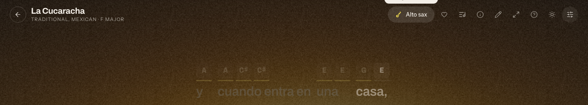
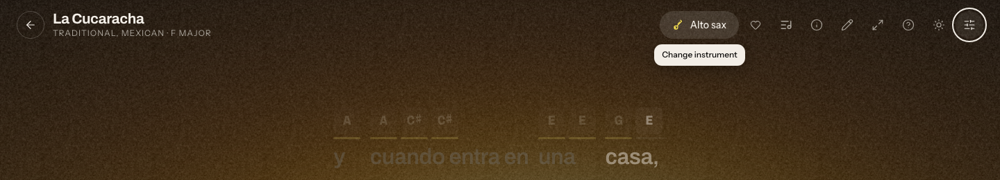
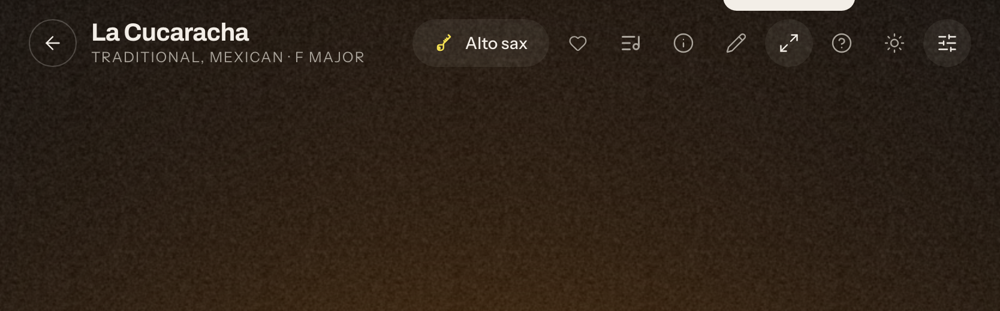

# Player polish: tooltips, looping, "Hear it played", sheet music

Work done in four parts, each committed on its own. Screenshots are in `docs/player-polish/shots/`.
Decisions made along the way are noted under each part.

## Part 1: tooltips

**The problem.** The little labels on the buttons at the top of the player opened above the button, so
the top of the window cut them off. They were drawn with CSS inside the button, so any parent that
clips its contents could also cut them.

| Before | After |
| --- | --- |
|  |  |
|  |  |
|  |  |

**What changed.**

- One tooltip for the whole app (`web/src/components/TooltipLayer.tsx`). It is drawn in its own layer
  on top of the page and placed with Floating UI (`@floating-ui/dom`, MIT licence). It opens on the
  preferred side, flips to the other side when there is no room, and slides along the window edge
  instead of crossing it. No parent can clip it.
- The buttons at the top of the player now ask for "below".
- Everything that used the browser's own `title` tooltip (note chips, the instrument list, the "unsure"
  dot, "Add a note here") now uses the same tooltip, so they all look and behave alike.
- Timing: the first tooltip waits about a third of a second. Moving along a row of buttons then swaps
  the text at once, with no blink in the gaps between buttons. A click puts the tooltip away.
- Keyboard: moving with Tab shows the tooltip of the focused button; Esc closes it.
- Touch: a finger doesn't hover, so tooltips stay out of the way. The small "i" marks in Settings open
  on a tap.

**How it was checked.** A Playwright script hovered every element with a tooltip on the home page,
My songs, a song's page, the player, the player with Settings open and the player in edit mode, at
1440×900, 834×1194 (iPad), 390×844 (phone) and a short 1024×600 window. For each one it checked that
the tooltip was fully inside the window, showed the right text and did not cover its own button.
Result: 305 tooltips checked, 0 clipped or wrong. Sweeping the mouse across the row of top buttons:
6 tooltips seen, 0 moments without one. First tooltip: closed at 120 ms, open at 520 ms.

**Decisions.**

- Floating UI rather than Radix Tooltip: the app already marks tooltips with a `data-tip` attribute in
  about forty places; one small layer that reads that attribute fixes all of them without wrapping
  every button in a component.
- Tooltips are hints for the eye only. Every button keeps its own `aria-label` for screen readers.
